<div align="center">


<br />

# Ahmad Maruf Hossain

<a href="https://github.com/SpicyFalcon619">
  
</a>

<sub>[GitHub](https://github.com/SpicyFalcon619) &nbsp;/&nbsp; [LinkedIn](https://www.linkedin.com/in/ahmad-maruf-hossain/) &nbsp;/&nbsp; [Instagram](https://www.instagram.com/spicy_falconn/) &nbsp;/&nbsp; [Email](mailto:a.marufhossain619@gmail.com)</sub>

<br />



<br />



</div>

<br />

## Selected work

| | |
|---|---|
| [**Nestly**](https://github.com/SpicyFalcon619/nestly-core) | Student housing and flatmate matching near Dhaka campuses, built by a team of four on Next.js and Supabase. My proudest build, a fully original idea. [Live](https://nestly-core.vercel.app) |
| **Field Guides** | Interactive guides where every example runs in the browser: [Java](https://spicyfalcon619.github.io/java-field-guide/) (UIU's OOP courses), [Machine Learning](https://spicyfalcon619.github.io/ml-research-journey/) and [AI Engineering](https://spicyfalcon619.github.io/ai-engineering-journey/) |
| [**Drawer 378**](https://spicyfalcon619.github.io/University/) | My whole CSE degree as a searchable archive: 3,000+ files, 37 courses, in-page viewer and folder zips |
| [**Mandela Catalogue Field Guide**](https://github.com/SpicyFalcon619/mandela-catalogue) | Full-stack fan site with accounts, moderation and an admin CMS (Next.js, SQLite/Turso). [Live](https://mandela-catalogue.vercel.app) |
| [**Wastopia**](https://project-wastopia.vercel.app/) | Blockchain waste tracking. Best Emerging Team, UIU CSE FEST 2025 |
| [**YT-DeepNote**](https://github.com/SpicyFalcon619/YT-DeepNote) | Chrome extension for timestamped notes with Notion sync |
| [**ClearPath**](https://github.com/SpicyFalcon619/ClearPath) | University clearance system (PHP / MySQL) |

More on the [portfolio](https://spicyfalcon-portfolio.vercel.app) and the [desktop-style portfolio](https://spicyfalcon-os.vercel.app).

## Stack


## This week

<!--START_SECTION:waka-->

```txt
Total Time: 11 hrs 43 mins

Markdown      5 hrs 24 mins         █████████▒░░░░░░░░░░░░░░░   37.89 %
Other         2 hrs 33 mins         ████▒░░░░░░░░░░░░░░░░░░░░   17.93 %
Java          1 hr 53 mins          ███▒░░░░░░░░░░░░░░░░░░░░░   13.26 %
Python        1 hr 21 mins          ██▒░░░░░░░░░░░░░░░░░░░░░░   09.51 %
Text          1 hr 4 mins           ██░░░░░░░░░░░░░░░░░░░░░░░   07.58 %
JavaScript    38 mins               █░░░░░░░░░░░░░░░░░░░░░░░░   04.45 %
```

<!--END_SECTION:waka-->
